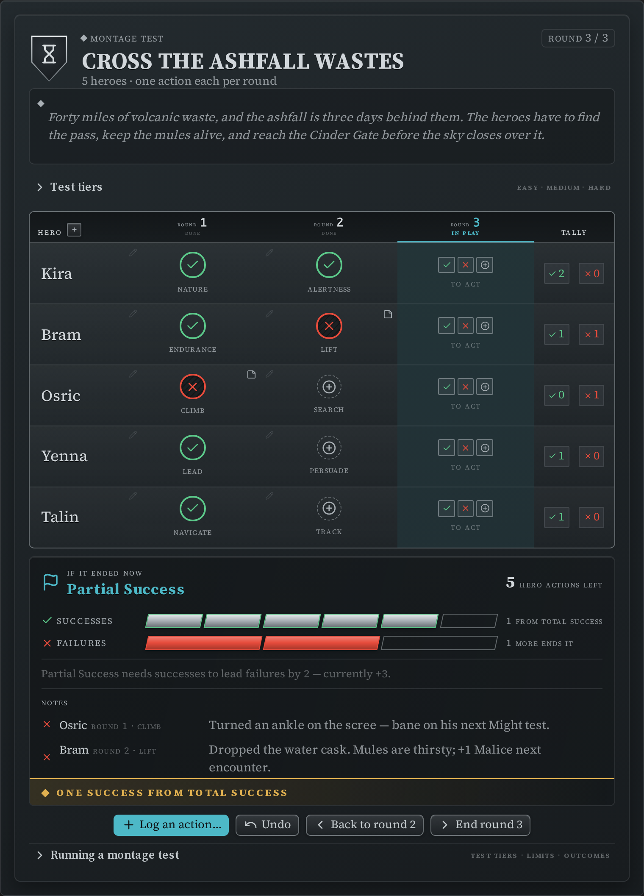
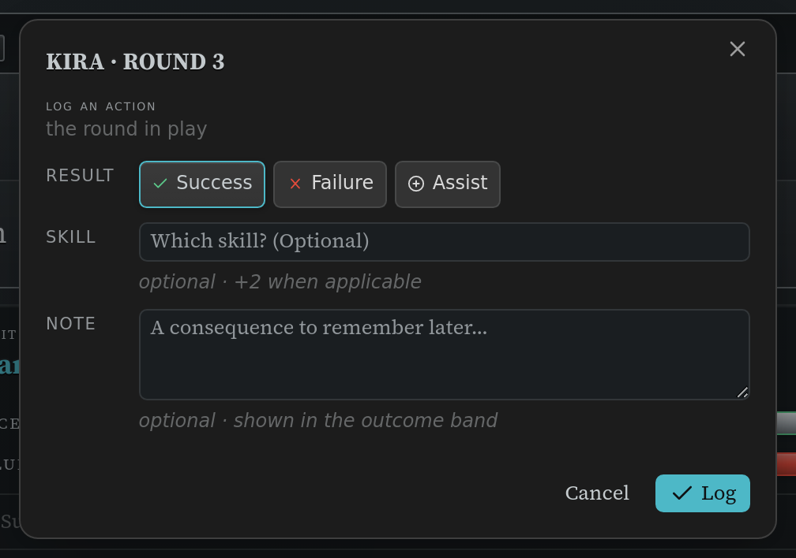

# Montage Test Tracker (`ds-montage`)

Like the other trackers, the montage tracker **writes its state back into the note** as you
use it.

```markdown
~~~ds-montage
title: Cross the Ashfall Wastes
description: |
  Forty miles of volcanic waste, and the ashfall is three days behind them. The heroes
  have to find the pass, keep the mules alive, and reach the Cinder Gate before the sky
  closes over it.
rounds: 3
success_limit: 6
failure_limit: 3
successes: 0
failures: 0
participants:
  - name: Kira
    skills_used: []
  - name: Bram
    skills_used: []
current_round: 1
~~~
```



A working board for a Draw Steel montage test: one row per hero, one column per round, and
a running tally beside each row. `description` is an optional brief — a few lines of prose
about the montage — shown above the board.

The running successes/failures under the outcome banner are the block's own kept totals,
not something recomputed from the board — the board shows the individual tests, the banner
shows the running score, and the tracker never re-derives one from the other. That's why a
hand-edited total (or a block from before this board existed) can disagree with what the
board shows and still be trusted: your kept total is never silently overwritten by a
recount.

**Logging an action.** Click directly on a hero's cell for the round in play (or the small
**+** beside a hero's name), and a small form opens for that hero and that round — both
are named in the form's title, "Kira · round 3". Pick success, failure or assist, and
optionally name the skill used and add a note. Nothing is written until you press **Log**.
The **Log an action…** button at the bottom of the card opens the same form for the next
hero who hasn't acted yet this round; once every hero has acted, it's greyed out — end the
round, or click a cell to correct it. The form doesn't let you switch to a different hero
or round — close it and click the cell you want instead. For a reminder of which power
roll result counts as a success at each difficulty, open the **Test tiers** strip above
the board.



For an empty cell in the round currently in play, three small buttons sit right in the
cell — a check, an X, and a plus — so you can log a success, failure, or assist in one
click with no skill and no note; click the cell itself, or use **Log an action…**, when
you want to record a skill or a note too.

**Correcting a mistake.** Click an already-logged cell (it shows a small pencil mark) to
open the same form pre-filled with what's recorded, so you can change the result, the
skill, or the note — or remove it outright with the **Remove** button. This is also how you
fix a hero's typo'd result if you ever hand-edit the note directly. An empty cell from an
earlier round works the same way — click it to add a test you forgot to log at the time —
but only while the montage is still in play. Once it's finished, reopen it first (only
possible if it simply ran out of rounds; a limit is final).

**Notes.** Anything you type in a test's Note field — a consequence, a complication, a
reward — shows up listed under the outcome banner below the board, tagged with the hero and
round it happened in.

**The skill-reuse rule.** A hero can't use the same skill twice in one montage (the book's
own rule). The tracker warns you right in the form when you try — it never blocks you,
since the Director always has the final call.

**Test tiers and running the montage.** Above the board, **Test tiers** is a collapsed
strip you can open for a quick-reference table of what each power roll result means at
each difficulty (with any reward or consequence noted). Below the board, **Running a
montage test** is a collapsed panel covering the same tiers plus how to set limits and how
a montage ends — leave both closed for a quick glance, or open either when you need the
detail.

**Ending a round.** Below the board, next to **Log an action…**, the **End round N**
button moves everyone on to the next round — it's the only way to advance the round short
of hand-editing the block. If ending a round uses up the last one and no limit has been
hit, the montage finishes there (the outcome banner updates on its own).

**Undoing the last thing you logged.** The **Undo** button in the same bar removes
whatever was logged most recently — handy right after a slip of the finger. It only undoes
the single most recent entry; for anything further back, click that cell directly to
correct or remove it.

**Going back a round.** Ended a round too early? From round 2 on, **Back to round N** (just
before **End round**) returns the montage to the previous round. It only moves which round
is in play — nothing you logged is removed, so anything already logged in the round you
left is still there when you end the round again (Undo it first if it shouldn't count). It
is also offered on a montage that finished by running out of rounds, to step back into its
last round. Once a success or failure *limit* has been hit, there's no going back a round —
that result is final.

**When a montage finishes.** The bar under the board changes: **Undo** stays (so you can
take back the action that just finished it), **Back to round N** and **Reopen** appear if
the montage simply ran out of rounds with no limit reached (Back steps into the last round
again; Reopen adds one more round and picks up where you left off), and **Clear all** wipes
the running successes, failures, the round, and everyone's logged actions and used skills
so the same block can run the montage again from the top. Once a success or failure
*limit* has actually been hit, that result is final — **Back to round N** and **Reopen**
aren't offered, and **Clear all** is the only way back.

**The card's menu (⋯).** Hover the card for its menu panel: **Add a round** extends the
montage by one round; **Add a hero** adds a new participant by name; **Set limits…** opens
a small form to change the success/failure limits; **Reset progress** clears the running
successes, failures, the round, everyone's logged actions and used skills — your setup
(title, description, limits, roster) survives it, so the same block can run the montage
again. (This is the same reset **Clear all** performs once the montage is finished — just
reachable at any time, not only once the board is done.)
