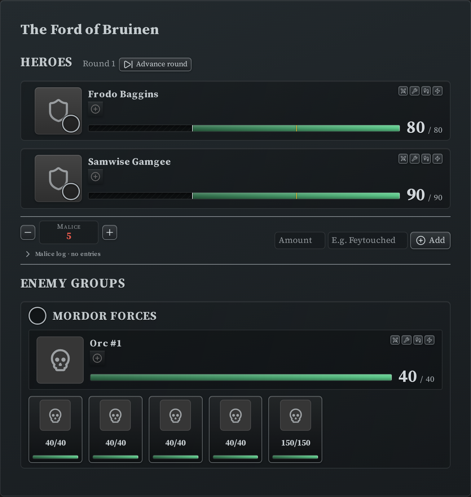
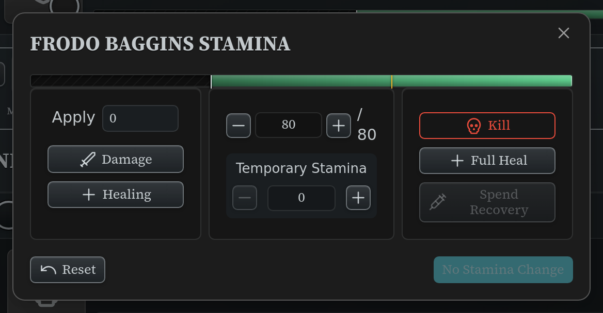
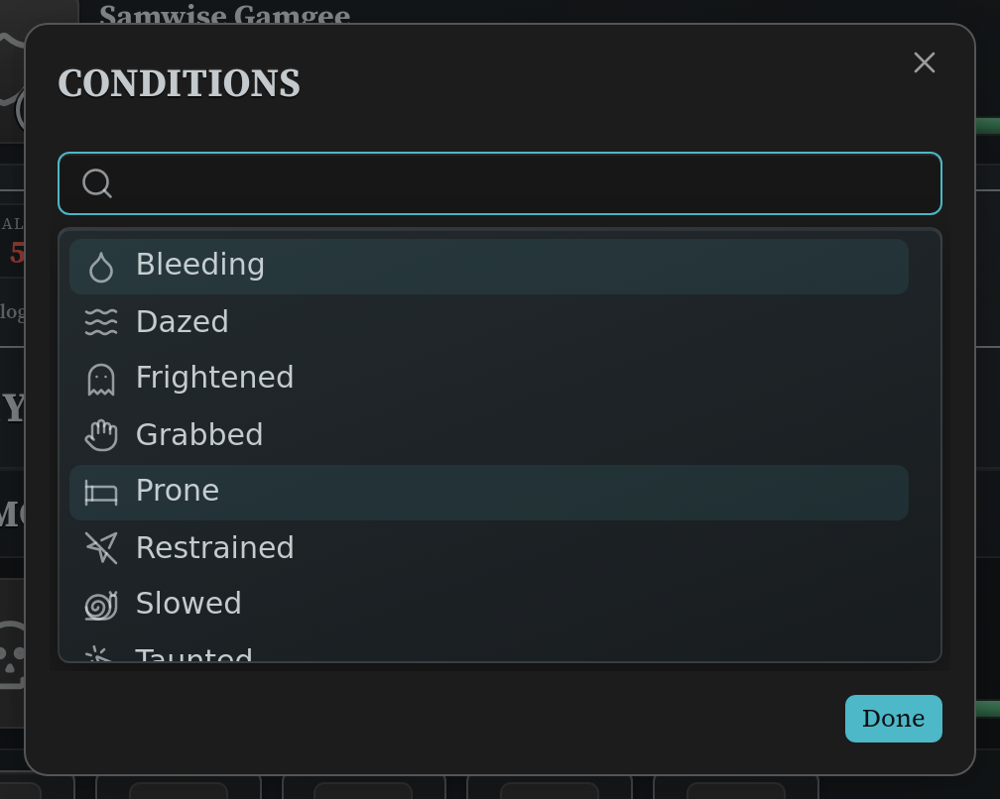
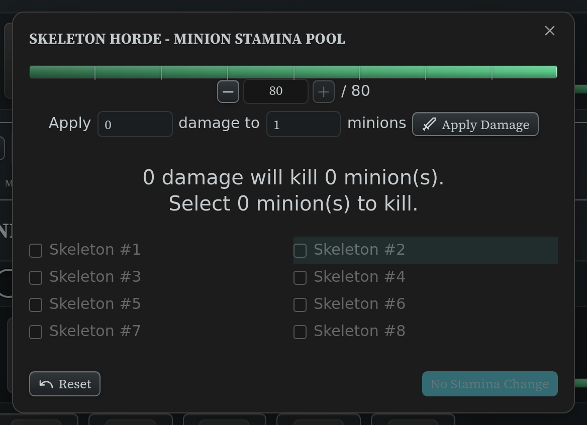

# Run an Encounter

From "I want a fight here" to running it at the table. The **initiative tracker** does the
work: you tell it who is in the fight, and it keeps turn order, Stamina, conditions and
Malice for you.

New to the plugin? Start with [Getting started](getting-started.md).

The example below references its monsters by compendium code, so it needs the compendium
synced first (**Settings → Draw Steel Elements → Compendium → Sync**). Without a sync those
creatures show a "not available in this vault" card; you can always type a creature out
instead, with a `name` and `max_stamina`.

## 1. Set up the fight

In **Editing view**, type `/ds` and pick **Initiative tracker**. You get a worked example to
edit. Replace it with your party and the monsters in the fight:

```
~~~ds-initiative
name: Ambush at the ford
heroes:
  - name: Aria
    max_stamina: 60
  - name: Brom
    max_stamina: 80
enemy_groups:
  - name: Goblin ambushers
    is_squad: true
    creatures:
      - statblock: scc.v1:mcdm.monsters.v1/monster.goblin.statblock/goblin-runner
        amount: 6
        squad_role: minion
  - name: The dragon
    creatures:
      - statblock: scc.v1:mcdm.monsters.v1/monster.dragon.statblock/crucible-dragon
        amount: 1
malice:
  value: 3
~~~
```

A creature with a `statblock:` reference takes its name, Stamina and image from that
statblock, so you don't type them. You don't have to type the codes by hand either: use
**Insert Draw Steel: compendium reference** in the command palette to search for a
creature, drop the block it writes anywhere, and copy the code out of it — or hold
**Ctrl/Cmd** when you pick a search result to copy the code straight to your clipboard.
Every field is listed in [Initiative Tracker](initiative-tracker.md).

Switch to **Reading view** and the fight is ready.

## 2. Run it



At the table:

- **Turn markers** — click the circle by a name when they've gone.
- **The action checklist** — each actor has [Main] [Maneuver] [Move] [Triggered] chips.
  Click them off as they're spent. "Triggered" clears per round, the rest per turn.
- **Stamina** — click any Stamina number for the damage/healing editor.



- **Conditions** — the `+` in a row opens the Conditions manager: type to add (including
  a custom one for anything the catalog doesn't cover), click the trash icon to remove.
  For a quick single removal you can skip the manager and click the condition's own icon
  in the row instead.



- **Minion squads** — a squad shares one Stamina pool. Click a minion to select it, then
  click the pool to open its editor, which walks you through which minions die.



- **Malice** — the panel tracks the pool, logs every gain and spend, and can add a set
  amount each round. Use "Quick-add" for a one-off ("3 — Feytouched").

### Two buttons that are not the same

- **Reset turns (this round)** — in the tracker's menu (hover it; the icon panel above the
  top-right corner) — clears the turn markers and action chips without moving the round on.
  Use it when you mis-clicked.
- **Advance round** — the button beside the "Heroes" heading — is the real round boundary:
  it clears those *and* bumps the round counter *and* grants the Malice you configured.

## See also

- [Initiative Tracker](initiative-tracker.md) — every field and control
- [Montage Test tracker](gm-trackers.md) — for a montage test
- [Negotiation tracker](negotiation-tracker.md) — for the fights that aren't fights
