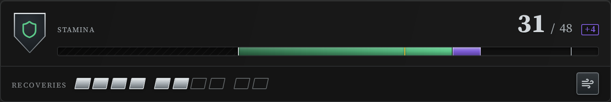
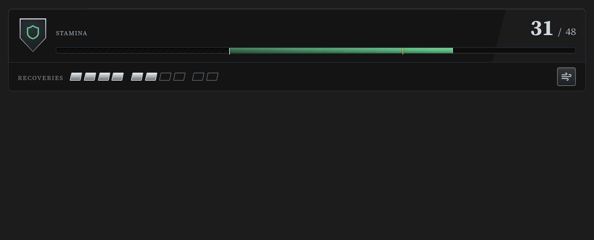
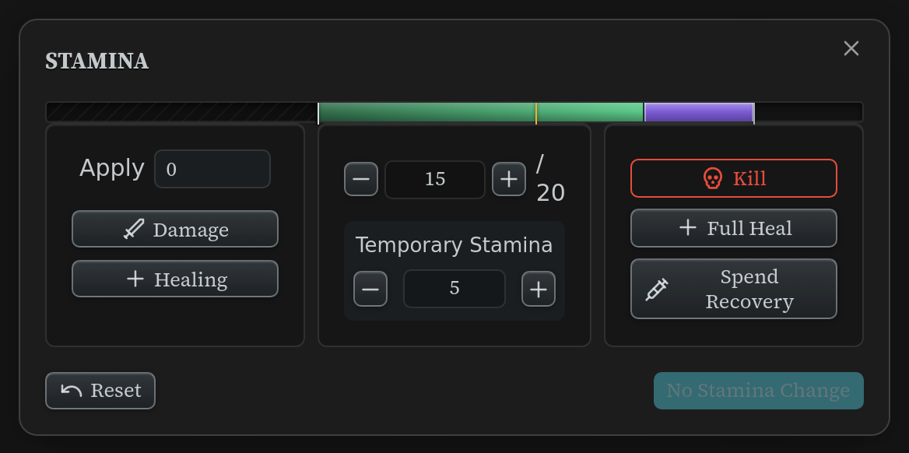

# Stamina Bar Element

The Stamina Bar Element is a tool designed to parse and display a character's stamina within Obsidian.
It allows you to define a character's maximum stamina, current stamina, and temporary stamina using 
YAML syntax, and then renders this information as an interactive stamina bar for easy tracking during 
gameplay or writing.

## Usage

To use the Stamina Bar Element, insert a code block with the language identifier
`ds-stamina-bar` (or the shorter `ds-stamina` / `ds-stam`) in your Obsidian note, and then
define your stamina values using YAML syntax inside the code block.

### Example stamina bar:

```
~~~ds-stamina-bar
max_stamina: 20
current_stamina: 15
temp_stamina: 5
~~~
```

This code block will render the stamina bar with the specified stamina values.



This interactive bar visually represents the character's stamina, including any temporary stamina. 
Clicking on the bar allows you to adjust the stamina values directly.





## Field Definitions

The Stamina Bar can be collapsed from its standard menu panel (hover the bar; the control is
at the top-right), and honours `collapsible:`, `collapsed:` and `collapse_default:` from the
[Common Element Fields](common-element-fields.md). Collapsed, it reads as one line —
`STAMINA (31/48)`.

> **Changed in 7.0.0.** The bar used to carry its own "Stamina Bar" disclosure header. That
> header is gone; the menu panel does the same job the same way every other card element
> does. Existing blocks are unaffected — `collapse_default: true` still starts the element
> collapsed — with one exception: `collapsible: false` used to be silently ignored here and
> is honoured now.

Below is a detailed description of each field used in the stamina bar element, including their types, 
default values, and whether they are required.

| Field             | Type      | Description                                                   | Required | Default Value          |
|-------------------|-----------|---------------------------------------------------------------|----------|------------------------|
| `max_stamina`     | `integer` | The maximum stamina value of the character.                   | **Yes**  | N/A                    |
| `current_stamina` | `integer` | The current stamina value of the character.                   | No       | Value of `max_stamina` |
| `temp_stamina`    | `integer` | Temporary stamina added to the character (e.g., from buffs).  | No       | `0`                    |
| `recoveries`      | `integer` | Recoveries remaining in the pool.                              | No       | Not tracked if omitted |
| `recoveries_max`  | `integer` | The size of the Recoveries pool.                               | No       | Not tracked if omitted |
| `height`          | `number`  | Adjusts the height of the stamina bar in the rendered output. | No       | `1`                    |

### Notes:

- **`current_stamina`** defaults to the value of **`max_stamina`** if not specified.
- **`temp_stamina`** represents any temporary stamina the character has gained and is added on top of the current stamina.
- **`height`** allows you to customize the visual height of the stamina bar to suit your preferences.
- **`recoveries`** / **`recoveries_max`** are both optional and additive: set `recoveries_max` (with `recoveries` for the starting count) to add a Recoveries pip row and a **Catch Breath** button under the bar. Omit both and the bar renders exactly as before — no pips, no button.

## Recoveries and Winded

When `recoveries_max` is set, the bar gains:

- A row of Recovery markers showing how many remain out of the pool. **Clicking a marker
  sets the count** — clicking the last available one spends exactly one, clicking the
  first spent one restores exactly one, and any distance is a single click (Draw Steel
  loses Recoveries in multiples, e.g. "the target loses 1d3 Recoveries"). The row is also
  a keyboard control: arrow keys step it, Home/End empty and refill it, and a click on a
  marker leaves the keyboard on the row so you can carry on with the keys. Every change
  offers an **Undo** in the notice that follows.
- A **Catch Breath** button that spends one Recovery to heal 1/3 of max Stamina (rounded
  down), capped at `max_stamina`. Disabled — with the reason as its tooltip — while Dying,
  with no Recoveries left, at full Stamina, or when the recovery value is 0 (a `max_stamina`
  of 2 or less), so it never spends a Recovery for nothing. The popover's "Catch breath"
  button follows the same rule. It is icon-only; hover it for the label.
- A **Winded**/**Dying** state, per the core rules ("Stamina and Death"): Winded at half
  Stamina max or below, Dying at 0 Stamina or below. The whole cluster carries it — the
  frame's colour, the crest's silhouette (shield → alert shield → skull), the state word,
  and the colour of the current-Stamina numeral — so it is never a colour alone. In print
  and PDF export it falls back to the badge beside the markers.

If you would rather not edit by clicking a marker, turn on **Settings → Element defaults
→ Advanced → "Edit Recoveries with a popover"**: a marker click — or an arrow key on the
row — then opens a small − / + popover instead of committing straight away, so no single
stray input can change the count.

```
~~~ds-stamina-bar
max_stamina: 48
current_stamina: 31
temp_stamina: 0
recoveries: 6
recoveries_max: 10
~~~
```

## Interaction

- **Clicking** on the stamina bar opens an editor where you can adjust the `current_stamina`, `max_stamina`, and `temp_stamina` values directly.
- The editor's **Spend Recovery** quick action heals 1/3 of max Stamina and spends one Recovery, when the bar
  tracks Recoveries (`recoveries_max` is set). On a bar that tracks none there is nothing to spend, so the button
  reads **Heal Recovery Value** instead (it heals the same amount and spends nothing), and the first press in an
  editor window asks you to confirm that before it heals. Cancel or Escape closes just that question.
- The stamina bar **automatically updates** to reflect any changes in the stamina values.
- The bar displays different colors or overlays to indicate various states (e.g., low stamina, temporary stamina).

## How to read the gauge

The bar is a forged gauge rather than a plain left-to-right fill, and it reads differently
on purpose:

- **Zero is a marked bulkhead, not the left edge.** Stamina pours rightward from it, and
  the engraved reserve to its left is the negative range the rules give a hero (down to
  −max/2). That reserve only fills once you are actually in it, so green always means
  "Stamina you have" and red always means "how far past zero you are" — they never share
  the same stretch of bar.
- **Temporary Stamina is a plate bolted on past the pour**, sharing its origin and scale.
  When temp is present the scale widens to `max + temp` and a separate mark shows where
  your real maximum sits, so the plate is always visible and never overflows.
- In a narrow pane (a sidebar leaf, roughly 400px or less) the whole cluster collapses to
  a two-line **rail**: the readout and gauge on one line, the Recovery markers and Catch
  Breath on the next.
